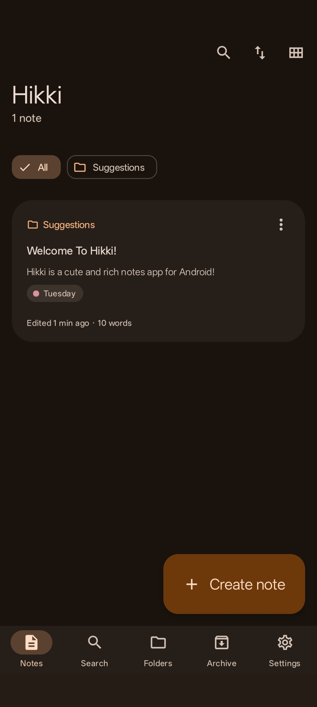
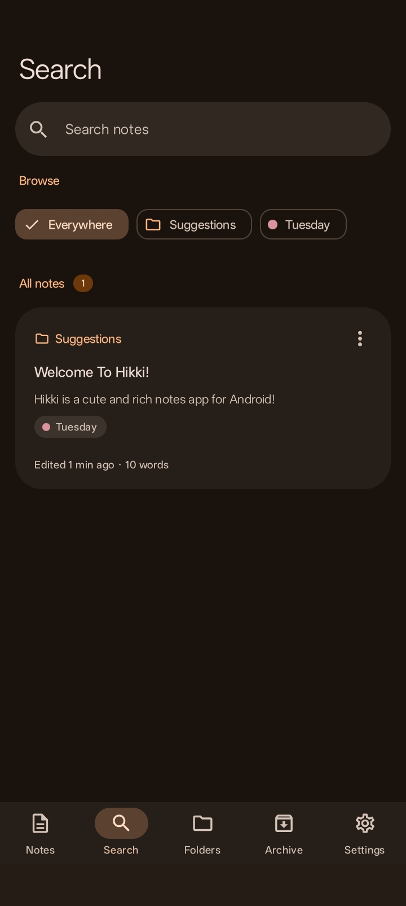
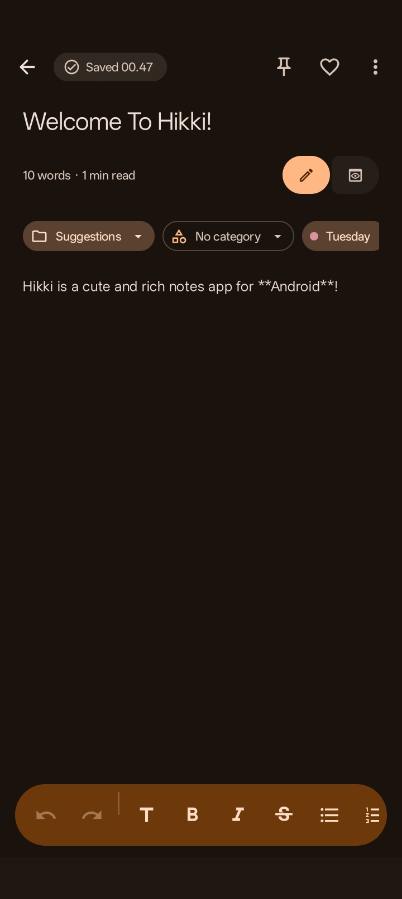

<a id="readme-top"></a>

<div align="center">


# Hikki · 筆記

**A cute, rich and private Markdown notes app for Android — built with Material 3 Expressive.**

<p>
  <a href="https://github.com/rukamori/Hikki/releases/latest"></a>
  <a href="https://github.com/rukamori/Hikki/releases"></a>
  <a href="LICENSE"></a>
</p>
<p>
  
  
  
</p>

<a href="https://github.com/rukamori/Hikki/releases/latest">
  
</a>

<p>
  <a href="https://github.com/rukamori/Hikki/releases/latest"><b>Download</b></a>
  ·
  <a href="https://github.com/rukamori/Hikki/issues/new"><b>Report a bug</b></a>
  ·
  <a href="https://github.com/rukamori/Hikki/issues/new"><b>Request a feature</b></a>
</p>





</div>

---

## 🌸 About

Hikki (筆記, *"notes"*) is an offline-first notes app that keeps everything on your device. Live preview the result as you type, organize notes with folders, categories and colorful tags — all wrapped in a Hikki!.

There are no accounts, no sync servers and no ads. Your notes live in a local database on your phone.

## 📦 Download

Grab the latest signed APK from **[GitHub Releases](https://github.com/rukamori/Hikki/releases/latest)**.

| Requirement | Version |
| --- | --- |
| Android | 8.0 (API 26) or newer |
| Target SDK | 37 |

## 🛠️ Build from source

**Prerequisites**

- Android Studio with Android SDK 37
- JDK 21

**Steps**

1. Clone the repository.

   ```bash
   git clone https://github.com/rukamori/Hikki.git
   cd Hikki
   ```

2. Build and install a debug build on a connected device.

   ```bash
   ./gradlew installDebug
   ```

   Debug builds use the `moe.rukamori.hikki.debug` application ID, so they install alongside a release build.

3. Or build a release APK. It is minified, so you need your own signing configuration.

   ```bash
   ./gradlew assembleRelease
   ```

## 🤝 Contributing

Contributions, bug reports and ideas are welcome.

1. Fork the project.
2. Create a branch: `git checkout -b feature/your-feature`.
3. Commit your changes: `git commit -m "feat: add your feature"`.
4. Push the branch: `git push origin feature/your-feature`.
5. Open a pull request.

## ❤️ Support

If Hikki makes your day a little cuter, you can support development:

- [GitHub Sponsors](https://github.com/sponsors/rukamori)
- [Buy Me a Coffee](https://buymeacoffee.com/morieattonkatsu)
- [Donate](https://miuka.moe/donate)

Starring the repository helps too ⭐

## 💬 Contact

- Telegram: [@rukamori](https://t.me/rukamori)
- Email: [me@koiiverse.cloud](mailto:me@koiiverse.cloud)

## ⚖️ License

Copyright © 2026 rukamori / morrieeattonkatsu

Hikki is free software: you can redistribute it and/or modify it under the terms of the **GNU General Public License v3.0** as published by the Free Software Foundation, either version 3 of the License, or (at your option) any later version.

This program is distributed in the hope that it will be useful, but **without any warranty**; without even the implied warranty of merchantability or fitness for a particular purpose. See [`LICENSE`](LICENSE) for the full text.

<p align="right">(<a href="#readme-top">back to top</a>)</p>
